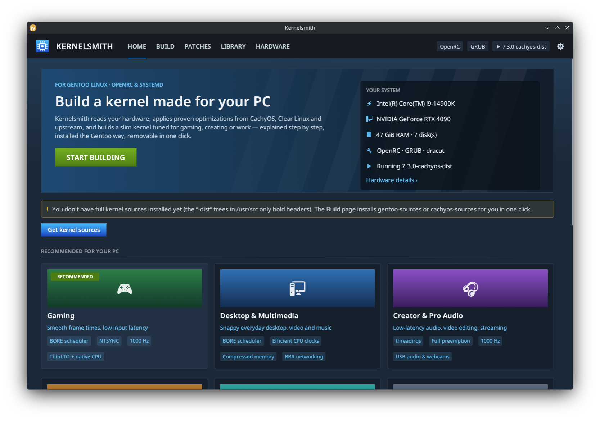
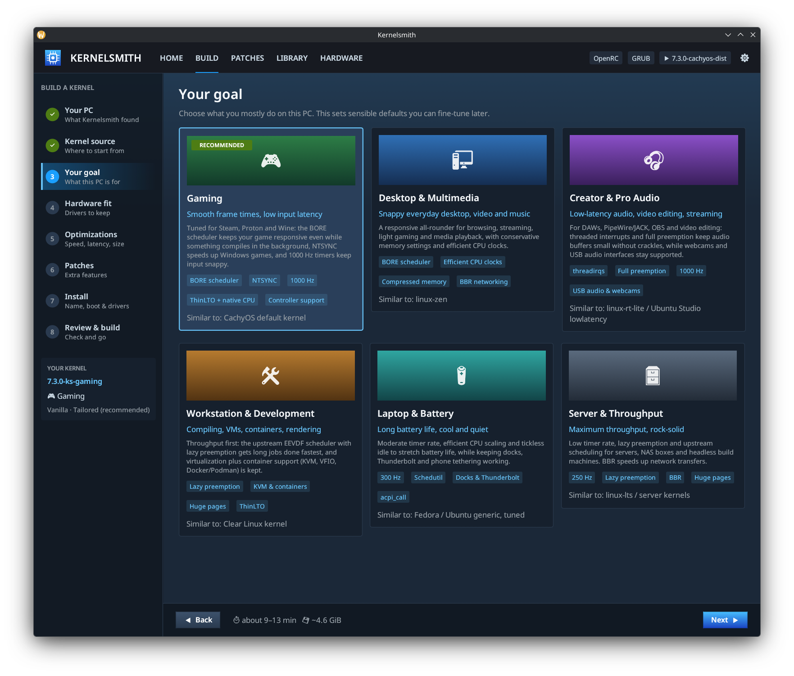
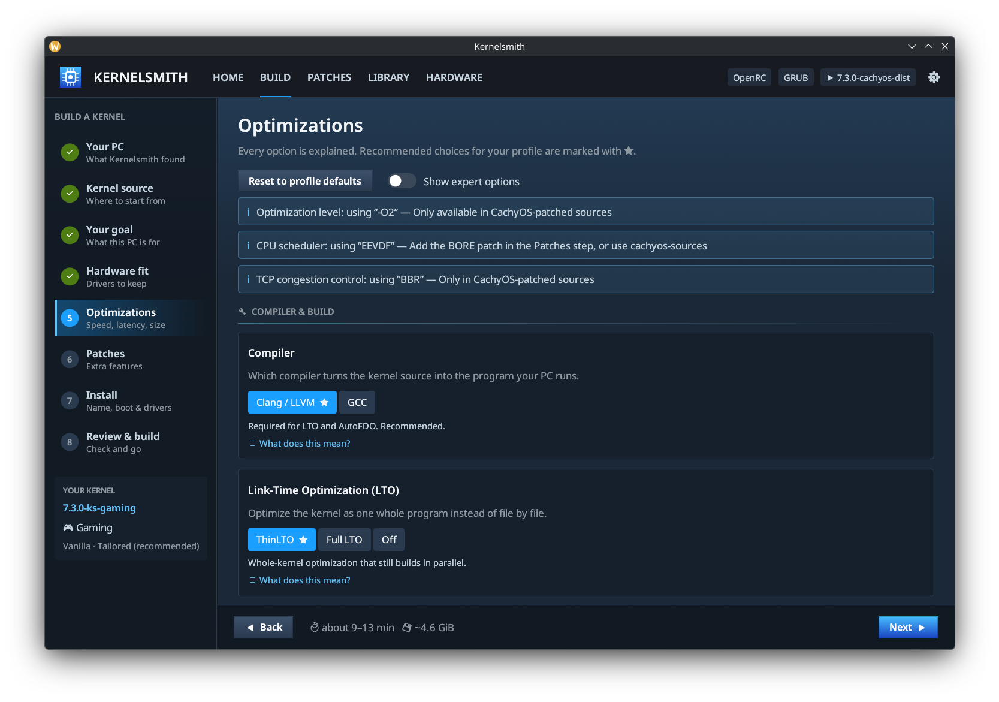
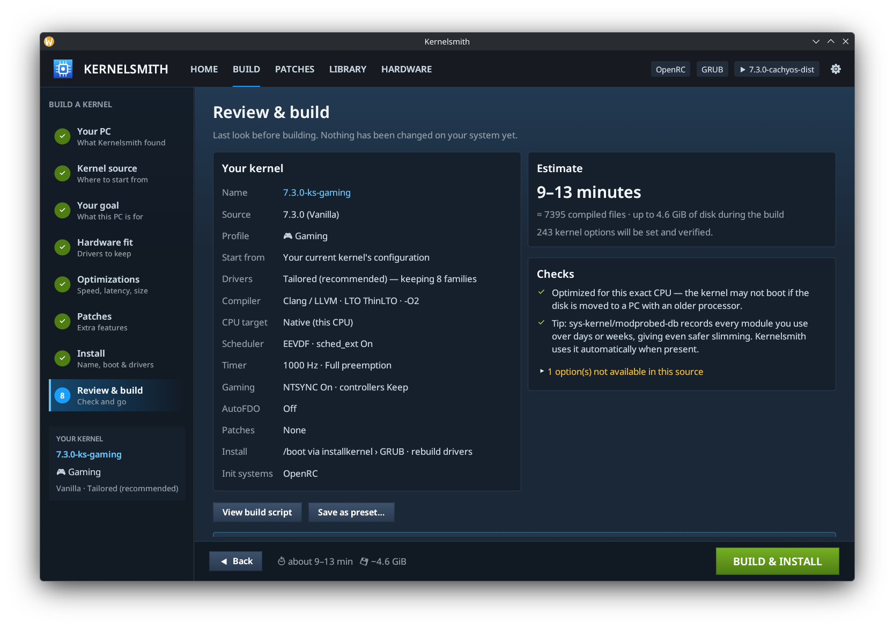
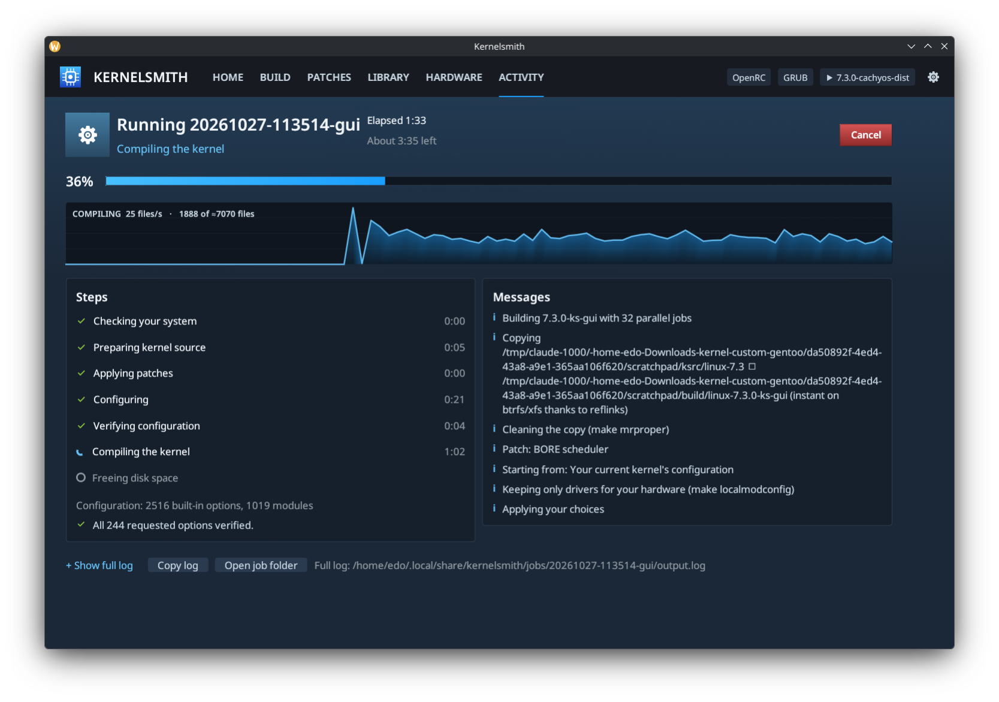

# Kernelsmith

**A guided, hardware-aware custom kernel builder for Gentoo — with a Steam-style GUI.**

Kernelsmith scans your PC, explains every choice in plain language, and builds a slim kernel
tuned for what you actually do: gaming, desktop and multimedia, pro audio, development, laptops or servers.
It installs the Gentoo way (through `installkernel`), works with **OpenRC and systemd**, rebuilds
your NVIDIA/out-of-tree drivers, and uninstalls cleanly.



| Pick a goal | Every option explained |
|---|---|
|  |  |
| **Review before anything changes** | **Live progress, Steam-download style** |
|  |  |

## What it does

- **Detects your hardware and system** — CPU micro-architecture (incl. Intel hybrid P/E cores),
  GPUs and drivers, disks, root filesystem, init system, bootloader, initramfs generator,
  installkernel USE flags, Secure Boot, toolchain, loaded modules and out-of-tree driver packages.
- **Six use-case profiles** that set sensible defaults (Gaming ≈ CachyOS default, Workstation ≈ Clear Linux…).
- **Optimizations** (each with "What does this mean?", risk level and availability for your source):
  Clang/GCC, **ThinLTO**/Full LTO, `-O3`, native CPU / x86-64-v3, **BORE**/EEVDF/BMQ/PDS,
  **sched_ext**, timer frequency, full/lazy/real-time preemption, tickless modes, THP, MGLRU,
  zswap + zram, **NTSYNC** for Wine/Proton, controller & Steam Input support, **BBR/BBRv3**,
  I/O schedulers, debug info/BTF, compression, Rust, built-in Clear-Linux-style boot options,
  CPU mitigations (expert).
- **Hardware fit (slimming)** with `make localmodconfig` plus "always keep" device families
  (USB storage, external filesystems, controllers, Bluetooth, USB audio, webcams, VPN, VMs,
  docks, tethering…) and optional **modprobed-db** history. Typically 4–8× faster builds.
- **Patch store**: CachyOS kernel-patches and upstream BORE matched to your kernel version,
  "already included" detection, one-click download, **read-only test-apply** (`patch --dry-run`),
  and your own patches (folder or import from URL).
- **Profile-guided optimization (AutoFDO + Propeller)** — the upstream-kernel version of the
  profile-guided compilation behind much of Clear Linux's speed: build "profile-ready", record
  your real workload with `perf`, rebuild with the profile. (True compiler PGO isn't upstream for
  the kernel; AutoFDO is the supported mechanism since Linux 6.13.)
- **Runtime tuning pack** (optional, removable): per-disk I/O schedulers via udev, sysctl
  tweaks (cache pressure, writeback, NMI watchdog, `vm.max_map_count` for games). Works with
  OpenRC's `sysctl` service and `systemd-sysctl` alike.
- **Library**: every installed kernel (Kernelsmith, Portage dist-kernel or manual), one-click
  **Rebuild with newest sources**, AutoFDO, config viewer, and **clean uninstall**.
- **Portage mode** for zero maintenance: export your choices as `/etc/kernel/config.d/*.config`
  (+ USE flags for `cachyos-kernel`, + `/etc/portage/patches`) so `emerge -u` rebuilds a
  distribution kernel with them forever.

## Why it's safe

- **Your source tree is never modified.** Builds run on a reflinked copy (`/usr/src/linux-<release>`),
  cleaned with `make mrproper`. Headers-only `*-dist` trees are detected and refused.
- **Nothing changes until you press Build.** The exact root script is shown in the Review step
  ("View build script") and saved with every job, so you can audit or run it yourself.
- **Every requested option is verified** after `make olddefconfig`. Boot-critical ones (root
  filesystem + disk controller built in, initramfs support, OpenRC/systemd requirements, NVIDIA
  requirements) abort the build if they don't stick; others are reported.
- **The kernel name is checked** (`make syncconfig && make kernelrelease`) before compiling, so a
  build can never overwrite an installed kernel.
- **A failed or cancelled build cleans up after itself** and installs nothing.
- **Uninstall removes exactly what was installed**: the script snapshots `/boot` and `/efi` around
  `make install` and records only new files carrying the kernel's name in
  `/var/lib/kernelsmith/kernels/<release>.toml`. The running kernel can't be removed.
- **Out-of-tree drivers keep working on your old kernels.** Portage removes the previous build's
  files when `@module-rebuild` reinstalls NVIDIA for the new kernel; Kernelsmith saves and restores
  them so the boot menu fallback still has graphics.
  (Those restored files are no longer tracked by Portage, so they stay behind if you later
  `--depclean` that old dist-kernel; delete its `/lib/modules/<release>` folder by hand then.)
- **Root only where needed**: the GUI runs as you; jobs run through `pkexec` (one password prompt
  per job), from a root-owned private copy of the script, in their own process group (Cancel works).

## Quick start

```bash
# Build tools (most are already in a Gentoo system)
emerge --ask --noreplace sys-devel/bc sys-devel/bison sys-devel/flex dev-libs/openssl virtual/libelf sys-kernel/installkernel
# Recommended extras: Clang/LTO/AutoFDO, sched_ext/BTF, profiling, long-term module history
emerge --ask --noreplace llvm-core/clang llvm-core/lld dev-util/pahole dev-util/perf sys-kernel/modprobed-db

# Build Kernelsmith as your user, install as root
make
sudo make install          # PREFIX=/usr for a system-wide path; default /usr/local
kernelsmith                # or start "Kernelsmith" from your application menu
```

Or install it from the **edorp** overlay (live ebuild `sys-kernel/kernelsmith-9999`, built from
`github.com/firesand/kernelsmith`):

```bash
echo "=sys-kernel/kernelsmith-9999 **" | doas tee /etc/portage/package.accept_keywords/edorp-kernelsmith
doas emerge -av sys-kernel/kernelsmith
```

You need **full kernel sources** in `/usr/src`. If you only have `*-dist` trees (from a
`*-kernel` distribution package), the app installs one for you in the Kernel source step, or:

```bash
emerge --ask sys-kernel/gentoo-sources
# or, with the CachyOS-kernels overlay enabled:
emerge --ask sys-kernel/cachyos-sources
```

`installkernel` decides how the kernel boots. For GRUB + dracut (the usual setup) enable
`USE="grub dracut"` on `sys-kernel/installkernel`; for systemd-boot use `systemd-boot`
(optionally `uki`). Kernelsmith shows what it detected on the first wizard page.

## The wizard

1. **Your PC** — what was detected and whether everything needed is installed.
2. **Kernel source** — pick a tree (newest + CachyOS/Gentoo preferred), or install one.
3. **Your goal** — Gaming, Desktop & Multimedia, Creator & Pro Audio, Workstation, Laptop, Server.
4. **Hardware fit** — how much to trim, which device families to always keep, base config
   (your running kernel's `/proc/config.gz` by default, upstream defconfig, a file, or CachyOS's
   config), and OpenRC/systemd support (both can be enabled).
5. **Optimizations** — all options grouped by topic; ★ marks your profile's recommendation.
6. **Patches** — catalog patches for your version and your own.
7. **Install** — kernel name, installkernel, driver rebuild, `/usr/src/linux` symlink,
   cleanup, runtime tuning, parallel jobs — or **Export to Portage**.
8. **Review & build** — summary, checks, estimate, the script, save as preset, **BUILD & INSTALL**.

After a successful build: reboot and choose the new kernel in your boot menu (GRUB usually makes
the newest kernel the default). Your previous kernel stays installed as a fallback.

## Module signing & anti-cheat readiness

*Optimizations → Security* has three related options:

- **Module signing** — *Sign* makes the build sign every in-tree module and, after
  `emerge @module-rebuild`, Kernelsmith signs the out-of-tree ones (NVIDIA, xpadneo, …) with the
  same key. The key is created once in `/etc/kernelsmith/keys/modules-signing.pem` (root, readable
  by the `portage` group) and reused by every build; `/etc/portage/env/kernelsmith-modules-sign.conf`
  plus a `package.env`/`package.use` entry per driver package keep Portage signing them on later
  rebuilds. If Portage already has a `MODULES_SIGN_KEY` (make.conf or an env file), that key is
  used instead, so one machine never ends up with two signing keys. *Sign and enforce* additionally
  sets `MODULE_SIG_FORCE`, so unsigned modules never load.
  (`modinfo -F signer` only shows the signer when `sys-apps/kmod` has `USE=pkcs7`.)
- **Anti-cheat readiness** — builds in what Easy Anti-Cheat Linux v2 checks on the machine
  (lockdown LSM armed early, BPF LSM, `lsm=` order, IOMMU with DMA translation, TPM 2.0 drivers,
  no MOK keyring trust) and, with GRUB, adds a second menu entry *Gentoo (EAC) <release>* that
  boots the same kernel with `lockdown=integrity lsm=landlock,lockdown,yama,integrity,bpf
  iommu.passthrough=0 module.sig_enforce=1 sysctl.kernel.kexec_load_disabled=1` (plus
  `intel_iommu=on` on Intel). Your normal entry stays unlocked. Epic additionally requires a kernel
  signed by a key on its well-known list, which no self-built kernel satisfies — this option gets
  everything else out of the way.
- **This PC only** trims (expert options): CPU count and single-node memory (`cpu_trim`), no
  VM-guest code (`guest_trim`), the other CPU vendor's extras, absent CPU features and absent GPU
  drivers (`platform_trim`), unused LSMs (`lsm_trim`), and the three hardening defaults with a
  runtime cost (`hardening`, off by default).

The *Hardware fit* step also gained families for encrypted/loop/zram disks with their ciphers,
more filesystems, Docker/VM networking (br_netfilter, macvlan, vxlan, …), sensors/RGB
controllers and optical drives/USB serial adapters — the modules that a plain `localmodconfig`
drops because nothing had loaded them yet.

## Keeping it up to date

- **Presets** remember every choice. Library → *Rebuild with newest sources* (or a saved preset)
  reuses them on the newest source tree in two clicks.
- **Command line / hooks**:

  ```bash
  kernelsmith build --preset ~/.config/kernelsmith/presets/gaming.toml --latest
  ```

- **Portage mode** (Install step → *Export to Portage…*): your choices become a config fragment
  merged by `kernel-build.eclass`, so `gentoo-kernel` / `cachyos-kernel` / `vanilla-kernel` are
  rebuilt with them on every update. Remove it from Library → *Runtime tuning & Portage*.

## Uninstalling

| What | How |
|---|---|
| A kernel built with Kernelsmith | Library → select it → **Uninstall** (not possible for the running kernel) |
| Runtime tuning pack | Library → *Runtime tuning & Portage* → **Remove** |
| Portage integration | Library → *Runtime tuning & Portage* → **Remove** |
| The app itself | `sudo make uninstall` (kernels and settings are left alone) |
| All app data | `rm -rf ~/.config/kernelsmith ~/.local/share/kernelsmith ~/.cache/kernelsmith` and, as root, `/var/lib/kernelsmith` |

## Files and locations

| Path | Contents |
|---|---|
| `~/.config/kernelsmith/presets/*.toml` | Saved presets (plain TOML, editable) |
| `~/.config/kernelsmith/settings.toml` | App settings |
| `~/.local/share/kernelsmith/jobs/<stamp>-<name>/` | Each job: `plan.toml`, seed config, module list, patches, `build.sh`, `output.log` |
| `~/.local/share/kernelsmith/patches/` | Your own patches (also `/etc/kernelsmith/patches/`) |
| `~/.local/share/kernelsmith/autofdo/` | Recorded AutoFDO profiles |
| `~/.cache/kernelsmith/` | Downloaded patches and cached patch listings |
| `/usr/src/linux-<release>/.kernelsmith/` | The plan, final config, applied patches and logs of that build |
| `/var/lib/kernelsmith/kernels/<release>.toml` | Install manifest used for uninstall |
| `/etc/sysctl.d/90-kernelsmith.conf`, `/etc/udev/rules.d/60-kernelsmith-ioschedulers.rules` | Runtime tuning pack |
| `/etc/kernel/config.d/60-kernelsmith-<name>.config` | Portage mode fragment |
| `/etc/kernelsmith/keys/modules-signing.pem` (+ `.crt`) | Module signing key, created on first signed build |
| `/etc/portage/env/kernelsmith-modules-sign.conf`, `package.env/kernelsmith-modules-sign`, `package.use/kernelsmith-modules-sign` | Portage keeps rebuilt drivers signed |
| `/etc/grub.d/41_kernelsmith-eac-<release>` | Anti-cheat GRUB entry (removed with the kernel) |

## Command line

```text
kernelsmith                     Open the graphical app
kernelsmith detect [--json]     Show detected hardware and system setup
kernelsmith sources             List kernel source trees in /usr/src
kernelsmith list                List installed kernels
kernelsmith plan  [OPTIONS]     Prepare a build job and print the script path
kernelsmith build [OPTIONS]     Prepare and run a build (asks for your password)

  --profile gaming|desktop|creator|workstation|laptop|server
  --preset FILE  --source PATH  --latest  --name NAME
  --set KEY=VALUE    e.g. --set hz=500 --set scheduler=eevdf --set lto=full
  --patch ID         bore, prjc, acpi_call, handheld, aufs, hardened
  --patch-file FILE  --slim off|balanced|aggressive
  --no-install  --build-root DIR  --print  --save FILE
```

## Troubleshooting

- **"No full kernel source tree"** — install `gentoo-sources` or `cachyos-sources` (see above).
- **Secure Boot is on** — self-built kernels are unsigned; sign them (e.g. `sbctl`) or disable Secure Boot.
- **NVIDIA modules failed to rebuild** — the job reports it; don't boot the new kernel until
  `KERNEL_DIR=/usr/src/linux-<release> emerge @module-rebuild` succeeds (newer kernels sometimes
  need a newer `nvidia-drivers`).
- **The new kernel doesn't boot** — pick your previous kernel in the boot menu, then uninstall
  the new one from the Library. Every job folder has the full log.
- **Some options "couldn't be applied"** — their Kconfig dependencies weren't met in that source;
  the build continues (only boot-critical options are fatal).

## Architecture

```
crates/core   kernelsmith-core: no UI
  hw.rs            hardware, boot, init, toolchain and Portage detection
  sources.rs       /usr/src discovery (flavor, buildable vs headers-only)
  kconfig.rs       .config parsing, Kconfig symbol index
  tweaks.rs        option catalog: explanations, availability, Kconfig ops
  profiles.rs      use-case defaults           slim.rs   localmodconfig + keep families
  requirements.rs  boot/init/NVIDIA/CPU safety sets
  patches.rs       patch catalog, GitHub listings (cached), download, dry-run
  plan.rs          saveable plan, checks, estimates
  script.rs        the generated root build script (stage/verify markers)
  job.rs           job directories     library.rs  manifests, uninstall
  autofdo.rs       profiling workflow  portage.rs  config.d export   tuning.rs  sysctl/udev
crates/app    kernelsmith: CLI, privileged run-job helper, egui GUI (gui/*)
packaging/    desktop entry, icon, polkit policy, Gentoo ebuild (copy of the edorp one)
```

The GUI and CLI generate the same plain bash script; `kernelsmith run-job` executes it (as root
via pkexec) and streams `::stage::`, `::verify::`, `::note::`… markers back to the UI.

Development helpers: `KERNELSMITH_PAGE=build|patches|library|hardware`, `KERNELSMITH_STEP=0..7`,
`KERNELSMITH_SRC_ROOT=<dir with linux-* trees>`, and `KERNELSMITH_RUN_JOB=<job>/build.sh`
(watch a job prepared with `kernelsmith plan` in the Activity view). `make test` runs the tests.

## Credits

Option choices and patch sources draw on [CachyOS](https://github.com/CachyOS/linux-cachyos)
(and its [kernel-patches](https://github.com/CachyOS/kernel-patches)), the
[BORE scheduler](https://github.com/firelzrd/bore-scheduler), Clear Linux's published kernel
tuning, the upstream kernel's AutoFDO/Propeller documentation, and Gentoo's `distro/Kconfig`
and `kernel-build.eclass`. Patches remain under their authors' licenses.

License: GPL-2.0-or-later.
